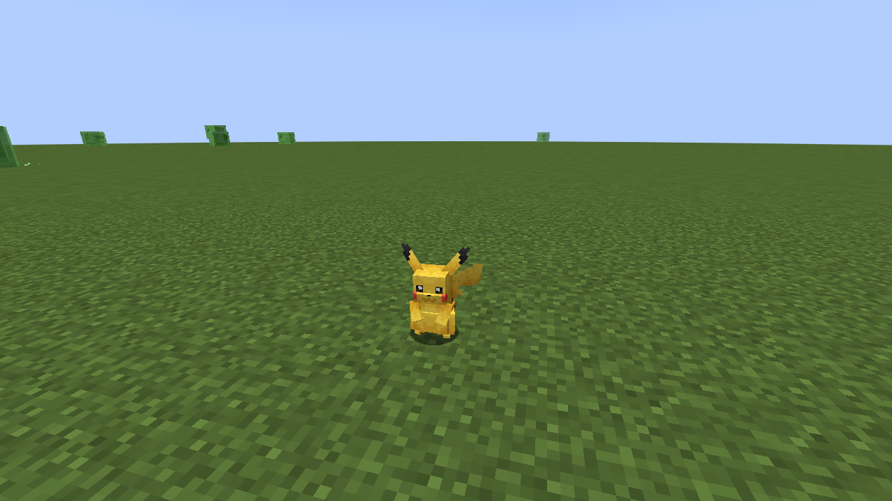
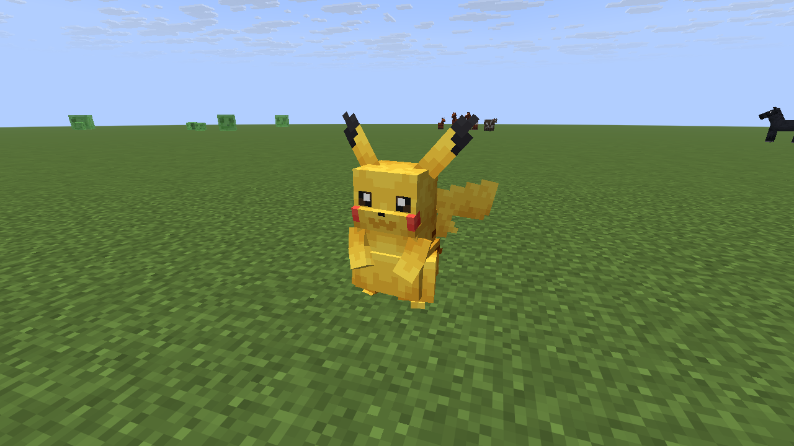
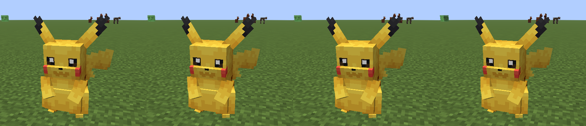

# cobblemon-link

**Cobblemon-style Pokémon on a plain Paper server, playable from vanilla Java *and* Bedrock, with no client mods.**

> Unofficial fan project. Not affiliated with or endorsed by the Cobblemon team, PokeDemo, Nintendo, Game Freak, Creatures Inc. or The Pokémon Company. Pokémon and its characters are trademarks of their respective owners.

## Purpose

[Cobblemon](https://cobblemon.com) is the best Pokémon experience in Minecraft, but it is a Fabric/NeoForge **mod**. Every player must install it, and **Bedrock players (phones, consoles) can't join at all.**

[PokeDemo](https://modrinth.com/plugin/pokedemo) shows that the gameplay can run as a Paper **plugin**. But its models and menus need its own Fabric client mod. Without that mod, players see invisible Pokémon with floating name tags (see [docs/screenshots](docs/screenshots)), and Bedrock players can never install the mod.

This repo tests a third approach:

- **Gameplay** runs as a Paper plugin.
- **Visuals** reach players as **server-sent resource packs**, which vanilla clients accept with one "Proceed" click.
- **Java:** [BetterModel](https://modrinth.com/plugin/bettermodel) renders Cobblemon's models with display entities and a generated resource pack.
- **Bedrock:** [GeyserModelEngine](https://github.com/GeyserExtensionists/GeyserModelEngine) turns the same models into native Bedrock custom entities. Geyser pushes the Bedrock pack automatically.
- **Models** are Cobblemon's own. They are already in Bedrock geometry format and are converted for Java by [`tools/geo2bb.py`](tools/geo2bb.py).

## Current state: visual prototype

| | Status |
|---|---|
| Cobblemon Pikachu model and idle animation on **vanilla Java 26.3** | ✅ verified (screenshots below) |
| Resource pack sent automatically to Java clients | ✅ verified |
| Bedrock pack generated and custom entity registered (`modelengine:pikachu`) | ✅ verified in server log |
| Model visible on a **Bedrock** client | ⏳ needs a device test |
| Species scale (Pikachu renders 2× too big) | ❌ not applied yet |
| Look-at, blink and battle animations | ❌ only `idle` and `walk` converted |
| Gameplay (spawning, catching, battles, party, PC) | ❌ not started |

| Cobblemon mod (Fabric client) | This repo (vanilla Java client) |
|---|---|
|  |  |

Idle animation on vanilla Java, four frames 0.5 s apart:



## Server load

Measured with 100 animated Pikachu and one viewer. Full details are in [bench/RESULTS.md](bench/RESULTS.md).

| | Tick time (50 ms = lag) | Total server CPU |
|---|---|---|
| This approach (Paper 26.3 + BetterModel) | 4.6 ms | 284% |
| Cobblemon mod (Fabric 1.21.1) | 17.6 ms | 43% |

The main thread does well. The cost is moved to async threads that stream bone animation to every viewer, so per-player Pokémon caps are needed.

## Try it

You need Docker. Accept the [Minecraft EULA](https://aka.ms/MinecraftEULA) before running.

```bash
cd server
./setup.sh                       # downloads the pinned, hash-checked plugins and installs models
docker compose up -d             # first boot generates configs
docker compose down && ./setup.sh && docker compose up -d
```

- Java: `localhost:25566`. Bedrock: `<host>:19133`.
- As an op, run `/bm spawn pikachu`.
- The resource-pack URL in `docker-compose.yml` is `127.0.0.1`, which only works for a client on the same machine. For real players, host `build.zip` at a public URL.

## Repo layout

```
assets/    converted Cobblemon models (CC BY-NC 3.0, see assets/README.md)
tools/     geo2bb.py: Cobblemon Bedrock geo + animation -> BetterModel .bbmodel + Bedrock input folder
server/    docker-compose + setup.sh for the prototype server (Paper 26.3)
bench/     load benchmark scripts, raw results and screenshots
docs/      screenshots, including PokeDemo on vanilla clients for comparison
```

Convert another species:

```bash
python3 tools/geo2bb.py <geo.json> <animation.json> <texture.png> <name> \
  assets/java/<name>.bbmodel assets/bedrock/<name> ground_idle=idle,ground_walk=walk
```

## Roadmap

1. Bedrock device test.
2. Apply the species scale and convert the look, blink and quirk animations.
3. Bulk-convert species from a pinned Cobblemon release.
4. Gameplay plugin: spawning, catching, party and PC, with battles on [Pokémon Showdown](https://github.com/smogon/pokemon-showdown) (MIT), which is what Cobblemon uses.
5. Measure network bandwidth per viewer, since bone streaming goes through tunnels and mobile data.

## Attribution

- **[Cobblemon](https://gitlab.com/cable-mc/cobblemon)** by the Cobblemon team and contributors.
  - All Pokémon models, animations and textures in `assets/` are adapted from Cobblemon 1.8.2 under **CC BY-NC 3.0**.
  - Cobblemon's code is **MPL-2.0**. No Cobblemon code is included yet. Any MPL file copied in future keeps its license header.
- **[PokeDemo](https://modrinth.com/plugin/pokedemo)** ([source](https://github.com/nn2048/PokedemoProject), **GPL-3.0**) by PtrMC / nn2048.
  - It inspired the Paper-plugin approach and was studied as a reference.
  - No PokeDemo code or assets are included. Its screenshots in `docs/` only document how it looks on vanilla clients.
- **[BetterModel](https://github.com/toxicity188/BetterModel)** (Java model rendering) and **[GeyserModelEngine](https://github.com/GeyserExtensionists/GeyserModelEngine)** / **[GeyserUtils](https://github.com/GeyserExtensionists/GeyserUtils)** (Bedrock bridge) are runtime dependencies. They are downloaded by `server/setup.sh` and not redistributed here.
- **[Geyser and Floodgate](https://geysermc.org)**, **[packetevents](https://github.com/retrooper/packetevents)** and **[Paper](https://papermc.io)** are also runtime dependencies and are not redistributed.

## License

- **Code** (`tools/`, `server/`, `bench/`): [MPL-2.0](LICENSE). It was chosen to stay compatible with Cobblemon's code license.
- **Assets** (`assets/`): [CC BY-NC 3.0](assets/LICENSE-CC-BY-NC-3.0.txt), inherited from Cobblemon. **Non-commercial use only.**
- Screenshots in `docs/` and `bench/` show third-party content and are included for documentation only.
